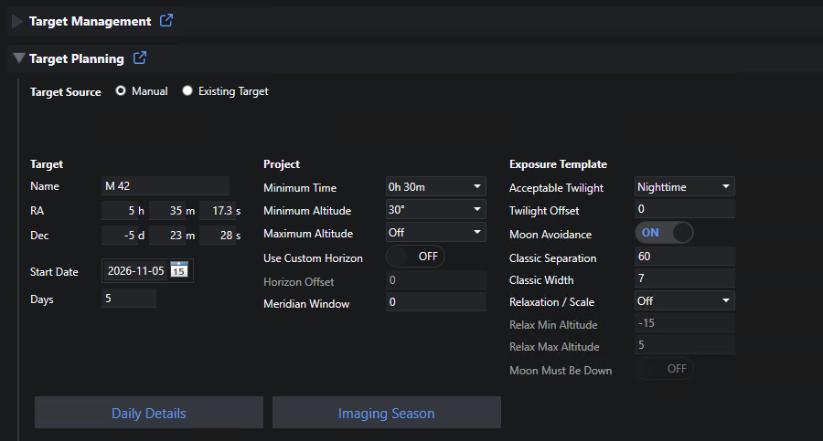
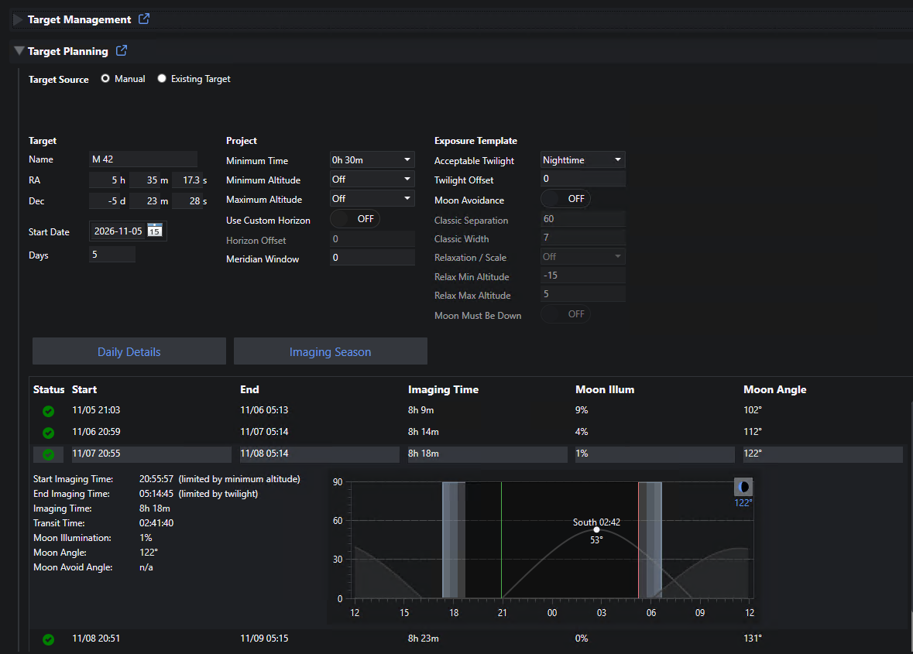
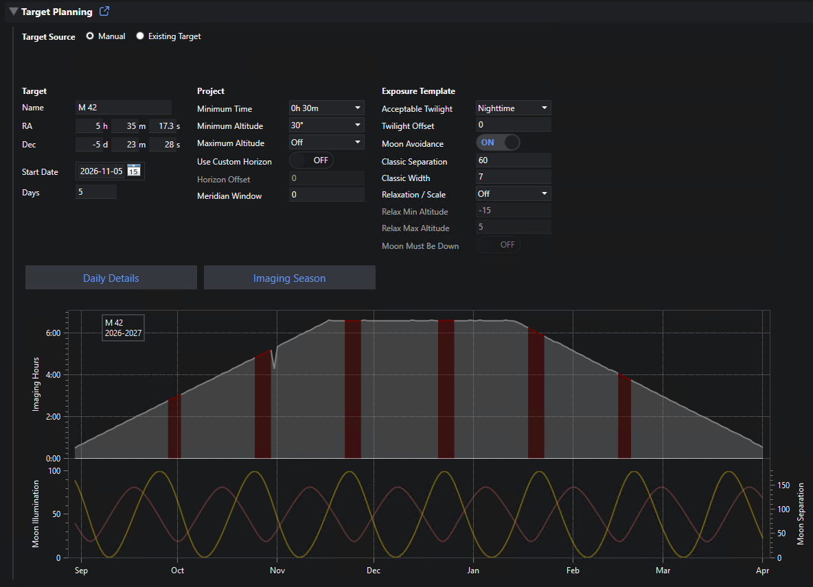

# Target Planning

Target Planning helps you visualize *when* a target can be imaged.  It shows the nightly imaging window for a target across a range of dates, or over its entire imaging season.  It is the successor to the separate Target Planning plugin, now integrated with Target Scheduler.

To get started, go to the plugin home page (NINA Plugins > Target Scheduler) and expand the Target Planning section.

Unlike the old plugin, Target Planning uses the same code that Target Scheduler uses for real scheduling.  This includes the [Planning Engine](concepts/planning-engine.html) visibility rules, twilight determination, horizon handling, and moon avoidance.  If Target Planning says a target can be imaged on a given night with a given set of parameters, the scheduler should agree.

## Target Source

There are two ways to provide the target and the parameters used for planning.  Select one with the Target Source buttons at the top of the panel.

### Manual

Enter everything yourself.  Type a name into the Name field to search the NINA object database: selecting a result fills in the RA and Dec.  You can also enter the coordinates directly.

All other parameters start at the Target Scheduler defaults for new projects and exposure templates.  The active NINA profile supplies your location and custom horizon.

Manual mode is best for quick 'what if' exploration of targets that you haven't added to Target Scheduler yet.

### Existing Target

Start from a target you've already defined in [Target Management](target-management/index.html).  Use the cascading selectors to choose the Profile, Project, Target, and Exposure Plan.  The target's name and coordinates are filled in, and every parameter is set from the project and the exposure plan's exposure template.

Exposure plans for the same target can use templates with different twilight and moon avoidance settings.  The plan you select is the one used for the calculation.

You can still change any parameter after selecting a target.  Changes in Target Planning are **never** saved back to the database, so you can experiment freely.  For example, you could see how many more nights you'd get by lowering the project's Minimum Altitude.

* Any parameter that differs from the saved target value is marked with an asterisk (*).
* Click Reset to Target to restore all parameters to the saved values.

Existing Target mode is best for checking the exact settings used for scheduling, and for testing changes before making them in Target Management.

### Opening from Target Management

When viewing a target in Target Management, click the calendar icon (Open in Target Planning) in the target's toolbar.  The Target Planning section opens in Existing Target mode with that target and its first exposure plan already selected.

## Parameters

The parameters are grouped in the same way as Target Scheduler groups them: the target, the project, and the exposure template.  Hover over any label for a short description.

### Target

| Parameter | Description |
| --- | --- |
| Name | The target name.  In Manual mode, typing here searches the NINA object database. |
| RA / Dec | The target coordinates. |
| Start Date | The first night to plan. |
| Days | The number of nights shown by Daily Details.  Imaging Season ignores this value. |

### Project

These have the same meaning as the corresponding [project properties](target-management/projects.html#project-properties), including the [horizon determination](target-management/projects.html#horizon-determination) rules.

| Parameter | Description |
| --- | --- |
| Minimum Time | The minimum imaging time span for the target on a night. |
| Minimum Altitude | The minimum altitude for the target (a floor when using a custom horizon). |
| Maximum Altitude | The maximum altitude for the target. |
| Use Custom Horizon | Use the custom horizon from the NINA profile. |
| Horizon Offset | Degrees added to the custom horizon. |
| Meridian Window | Limit imaging to this many minutes on either side of the meridian crossing (0 for off). |

### Exposure Template

These have the same meaning as the corresponding [exposure template properties](target-management/exposure-templates.html).  See [Moon Avoidance](target-management/exposure-templates.html#moon-avoidance) for details on the moon settings.

| Parameter | Description |
| --- | --- |
| Acceptable Twilight | The brightest acceptable twilight level. |
| Twilight Offset | Minutes to add to or subtract from the twilight times. |
| Moon Avoidance | Enable moon avoidance. |
| Classic Separation | Classic moon avoidance separation (degrees). |
| Classic Width | Classic moon avoidance width (days). |
| Relaxation / Scale | Scale the impact of relaxation, or turn it off. |
| Relax Min Altitude | Avoidance is turned off completely if the moon is below this altitude. |
| Relax Max Altitude | Classic avoidance applies if the moon is above this altitude. |
| Moon Must Be Down | Reject if the moon is above the relax Maximum Altitude, regardless of separation or phase. |

## Daily Details

Click Daily Details to show a table with one row for each night, starting at the Start Date, for the number of Days.

| Column | Description |
| --- | --- |
| Status | A check if imaging is possible that night, otherwise an X.  Hover over the icon to see the reason for rejection. |
| Start / End | The start and end of the imaging window. |
| Imaging Time | The length of the imaging window.  Shown in the warning color if it is less than the Minimum Time. |
| Moon Illum | The percentage of the moon that is illuminated. |
| Moon Angle | The separation between the target and the moon.  Shown in the warning color if moon avoidance rejects the night. |

Moon values are calculated at the midpoint of the imaging window.  When there is no imaging window, the midpoint of the dark period is used instead.

A night can be rejected for one of these reasons:

| Reason | Meaning |
| --- | --- |
| darkness | The night never reaches the Acceptable Twilight level. |
| never rises | The target never rises above your horizon. |
| not visible | The target isn't above your horizon during the acceptable twilight period. |
| not enough time | The target is visible, but for less than the Minimum Time. |
| meridian window | The meridian window leaves no usable imaging time. |
| maximum altitude | The target stays above the Maximum Altitude. |
| meridian flip | The meridian flip pause leaves no usable imaging time. |
| moon avoidance | The moon is too close to the target (see Moon Avoid Angle below). |

The table shows 22 nights per page.  Use the pager controls below the table to move between pages.

### Night Details

Click a row to open the details for that night.

* **Start / End Imaging Time:** the window boundaries.  Each boundary also shows what limited it: twilight, minimum altitude, custom horizon, maximum altitude, or meridian window.
* **Imaging Time** and **Transit Time:** the length of the window, and when the target crosses the meridian.
* **Moon Illumination** and **Moon Angle:** as in the table.
* **Moon Avoid Angle:** the minimum separation required by your moon avoidance settings at that time.  The night is rejected if the Moon Angle is less than this.  It shows 'n/a' when moon avoidance is off, or when relaxation has turned it off.
* **Chart:** an altitude chart for the night.  It shows the target, the moon, your horizon (custom or Minimum Altitude), and the twilight periods.

## Imaging Season

Click Imaging Season to show a chart of the target's whole imaging season.

* If the target can be imaged on the Start Date, the chart shows the season that includes that date.
* If it can't, the chart shows the next season after the Start Date.
* Days is ignored.

The calculation can take a few seconds.  Click the button again to cancel it.

The chart shows, for each night of the season:

* **Imaging hours:** the length of the imaging window.  The area is shaded differently for nights that are accepted and nights that are rejected, for example by moon avoidance.
* **Moon illumination:** as a line on its own axis.
* **Moon separation:** the angle between the target and the moon, as a line.

The season runs from the first accepted night to the last.  Nights rejected only by moon avoidance still count as in season, since the target is otherwise well placed.  Targets that are imageable all year (circumpolar) show a full year from the Start Date.  If the target is never imageable with the current parameters, a message says so.

You can drag and zoom the chart with the mouse.

## Live Updates

After you click Daily Details or Imaging Season, the results update automatically as you change parameters.  This includes selecting a different target or exposure plan in Existing Target mode.  The update runs shortly after you stop changing things, and:

* In Daily Details, an open row stays open and its chart is redrawn.
* In Imaging Season, the current chart stays visible until the new one is ready.

Imaging Season reuses cached twilight and visibility calculations, so updates after the first run are usually much faster.

## Differences from the Target Planning Plugin

If you used the separate Target Planning plugin, note these changes:

* **Parameters:** these now follow Target Scheduler projects and exposure templates.  Maximum and minimum altitude, custom horizon with offset, meridian window, twilight offset, and the full moon avoidance model (including relaxation and Moon Must Be Down) are all supported.
* **Maximum Moon Illumination:** this filter has been removed.  Moon brightness is handled by moon avoidance, as it is in the scheduler.
* **Imaging Season:** the start and end of the season are now taken from the nightly results using your actual parameters.
* **Annual Chart:** this has not been carried over.
* **HTML report:** the HTML report for Daily Details and Imaging Season is not yet available.
* **Plugin:** you no longer need the separate plugin.  You can uninstall it if you only used it with Target Scheduler.

---
